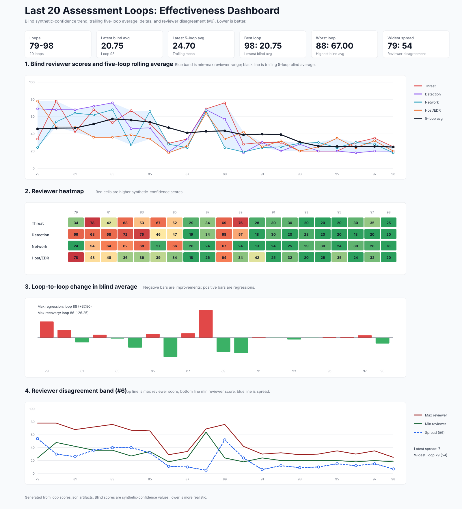

# Assessment loops 89–98 — completed November 11, 2026

Ten requested assessment loops and **40 independent expert reviews** are complete. Latest standalone
**synthetic-confidence score: 20.75/100**, lower is more production-like; five-score rolling mean 24.70.
Automated evaluation is **94.6124/100 FAIL**, 147,759 records: ground-truth agreement 88.3573 fails the
unchanged 95% hard gate. Strong raw-log reviews do not close this separate contract.

The authored canonical mixed-fleet benchmark, seed 42, default target and collection scope remain
unchanged. Final authoritative bundle:[loop95/bundle](loop-95/bundle/GENERATION_MANIFEST.json).
Four clean full generations and one preserved failed candidate were used; unchanged raw data were
reused with fresh neutral copies for later panels. All 118 source files are byte-identical across
loops 91, 94 and 95; metadata repairs therefore do not explain subsequent blind-score changes.

## Past ten loops — synthetic-confidence scores

TH=Threat Hunter; DE=Detection Engineer; NF=Network Forensics; HF=Host/EDR. Lower blind scores are
better. Rolling5 includes up to four immediately preceding historical loop means. Deliberation is a
facilitator synthesis retaining original votes, not a new independent measurement; it is excluded
from standalone means, rolling averages and dashboard trends.

| Loop | Automated eval | TH | DE | NF | HF | Blind mean | Interpretation | Deliberation | Rolling5 |
|---|---:|---:|---:|---:|---:|---:|---|---:|---:|
| 89 | 91.02 FAIL | 76 | 57 | 24 | 34 | 47.75 | mixed/inconclusive | 47.75 | 43.50 |
| 90 | 94.35 FAIL | 28 | 18 | 19 | 42 | 26.75 | mostly realistic | 26.75 | 38.90 |
| 91 | 94.48 FAIL | 30 | 30 | 24 | 25 | 27.25 | mostly realistic | 27.25 | 39.65 |
| 92 | 94.48 FAIL | 30 | 20 | 25 | 32 | 26.75 | mostly realistic | N/A | 39.10 |
| 93 | 94.48 FAIL | 20 | 28 | 29 | 20 | 24.25 | mostly realistic | 24.25 | 30.55 |
| 94 | 94.49 FAIL | 20 | 20 | 30 | 25 | 23.75 | mostly realistic | 23.75 | 25.75 |
| 95 | 94.61 FAIL | 20 | 20 | 24 | 35 | 24.75 | mostly realistic | 24.75 | 25.35 |
| 96 | 94.61 FAIL | 30 | 18 | 30 | 24 | 25.50 | mostly realistic | 25.50 | 25.00 |
| 97 | 94.61 FAIL | 35 | 20 | 28 | 32 | 28.75 | mostly realistic | N/A | 25.40 |
| 98 | 94.61 FAIL | 25 | 20 | 18 | 20 | 20.75 | mostly realistic | 20.75 | 24.70 |

## Individual expert summaries — final panel

**Threat Hunter:** Real, verdict confidence60, synthetic-confidence25. The bounded sample is mostly consistent with production telemetry: a mixed fleet has credible service traffic, routine processes, and investigable suspicious activity whose observed network and authentication ordering works. I found no demonstrated source-native contradiction in the two exact pivots; the modest Real verdict reflects this sample, not proof of provenance or a comprehensive lifecycle audit.

**Detection Engineer:** Inconclusive, verdict confidence80, synthetic-confidence20. The inspected records appear production-like and support ordinary SIEM parsing and correlation; this bounded review did not demonstrate a source-native contradiction or generator fingerprint. Correct schemas and coherent joins support realism, but cannot establish whether the underlying collection is real or high-quality synthetic telemetry.

**Network Forensics:** Real, verdict confidence58, synthetic-confidence18. The bounded network review found plausible protocol diversity, internally consistent connection accounting, and coherent early, middle, and late network evidence. I lean Real with modest verdict confidence: no substantiated synthetic defect emerged, but twenty inspected records and selected aggregates cannot establish provenance or rule out sophisticated synthesis.

**Host/EDR:** Inconclusive, verdict confidence80, synthetic-confidence20. The bounded endpoint sample is strongly production-like, with credible platform-specific process semantics and no demonstrated source-native contradiction. Two exact process pivots preserve identity, executable, ancestry, credentials, and execution ordering; the sample cannot establish provenance, so the classification remains inconclusive despite a low synthetic-confidence score.

## Deliberation findings

The final panel splits 2 Real / 2 Inconclusive. Facilitated synthesis preserves all original positions
and mean 20.75, distinguishes plausible samples from established provenance, and accepts capture gaps
as the explanation for 179 naive TCP accounting flags. No new concrete correction is supported.
The final panel spans early/middle/late records and uses 17–22 representative records per reviewer,
plus exact pivots and scoped aggregates. This remains bounded engineering evidence, not complete
native-version certification or proof of real origin.

## Fixed families

| Family | Owning layer | Verification |
|---|---|---|
| Raw Bash socket falsely acquires TLS | Typed pipeline submission adapter into canonical network planner | Exact callback retained; TLS contradiction 1 → 0; raw/encoded ports 443/8443 and unrelated-parent controls |
| Unmodeled RDP controller cannot reconnect | Shared RDP process-admission owner into exact reconnect bundle | Original address/LUID/session 4779 → 4778 retained; unavailable modeled source refused; routine+slow controls |
| Process timing proof double-counts delay | Independent timing-proof verifier | 239 false identity errors→0; delayed lifecycle and altered-clock negative controls |
| Group alias confused with expanded mailbox | Authored email verification | Requested To/Cc/Bcc parsed separately; exact typed group expansion; missing recipient/Bcc controls |
| Independent mail inherits authored intent | Canonical disk-backed message ownership | 8 unrelated messages across 4 actions → 0; late-hop/shared-action/explicit-intent/checkpoint-restore controls |
| ICMP required port/state differs from native fields | Shared source-native projection rules | 507 present expectations/field disagreements→0; unchanged raw telemetry; direct/sensor/negative controls |

Full family contracts, entry paths, consumers, layer rationale and residual risks are retained in
loop-specific reports and the [worklog](../../../docs/worklog/2026-11-11-iteration-test-loops89-98.md).
Zeek's [native connection reference](https://docs.zeek.org/en/current/scripts/base/protocols/conn/main.zeek.html)
confirms that ICMP tuple slots represent type/code. No gate, comparison tolerance or source coverage
policy was lowered; no rendered-row identity/timestamp patch or scenario retuning was used.

## Reported issues — prioritized improvements

| Priority | Issue | Category | Reviewer original rating | Score impact | Description |
|---|---|---|---|---|---|
| P1 | Remaining truth/source-observation agreement | contract_gap | Automated; not labeled by blind reviewers | High acceptance; blind impact unmeasured | 88.3573 < 95 remains a hard failure. Qualify remaining missing/duplicate, native-fact, source-admission and timing-dependency cases against exact records before changing their owners. |
| P2 | Shared Linux PID capacity floor | distribution_texture | Detection89:not labeled | Medium blind leverage |Ten hosts share a940-PID ten-minute mode; 67/350 final-data intervals hit it exactly. Model hidden workload and reorder capacity together while preserving chronological reservations, uniqueness, wrap and recovery. |
| P3 | Small DB TLS and endpoint command populations | weak_signal | Network/Host/Threat:not labeled | Low, contextual |Legacy TLS choices, service commands and Mac inventory repetitions are measurable but operationally explainable. Verify client/workload/collection intent before altering them. |

### Priority rationale and next work

First reconcile source expectation/canonical metadata with actual evidence while retaining the 95%
acceptance gate. The final inventory records 17,398 correct and 2,831 incorrect checks, 4,854 findings
and 4,467 separately classified coverage gaps; these are different measures, and a coverage gap is
not automatically a failure. See [the inventory](loop-97/acceptance-failure-inventory.json).

Then redesign PID workload/capacity allocation with chronological, out-of-order and exact-recovery
acceptance. The current 94/minute clipping floor is twice the 47-slot 30-second reorder capacity;
changing only rendered PIDs or cron times would conceal the cause. Both remaining product items
are in [TODO.md](../../../TODO.md). No further Mac source/helper expansion is implied.

Path escaping, static Mac callsite metadata, collection boundaries, complete joins and narrative
compactness were not accepted as defects without concrete source-native evidence. On unchanged
data, later score movement is reviewer/sample variance rather than a new fix effect.

## Comparison with quantitative evaluation

Final pillars:parseability 100.00, plausibility 95.67, causality 98.22, timing 90.81 and ground-truth
agreement 88.36. The expert panel assesses raw native plausibility and distributions; the failed gate
checks canonical/source assertions they cannot see. Neither result replaces the other. Historical
four-pillar scores before the new schema-v5 gate are not directly equivalent to this five-pillar run.

## Validation and artifacts

- 255 focused routine tests passed, 9 selected-file slow tests excluded; targeted RDP slow test 1 passed.
- Full routine run in the sandbox: 20,179 passed, 50 skipped, 5 failed and 1 fixture error
  (2,450 slow/soak cases deselected; 2,096.90 seconds). All six affected native Studio
  helper/census cases pass outside the sandbox with unchanged code: 1 census test plus
  6 helper/ownership tests (one overlaps an already-passing case). This validates
  20,185 unique routine cases; see [validation.json](loop-98/validation.json).
- Ruff check/format, 102-file config validation, behavior manifest 509 and diff checks pass.
- 40 reports contain required sections and both confidence values; 10 score artifacts use canonical
keys and recomputed means. All authoritative evaluations verify their bundle integrity.
- Product versions unchanged; no commits, tags, publication or scenario edits requested/made.

The dashboard covers 79–98, uses standalone scores only, and includes reviewer lines, rolling 5,
heatmap, deltas and disagreement band. Its SVG was XML-parsed after rendering. Earlier history
and every original report remain preserved.
