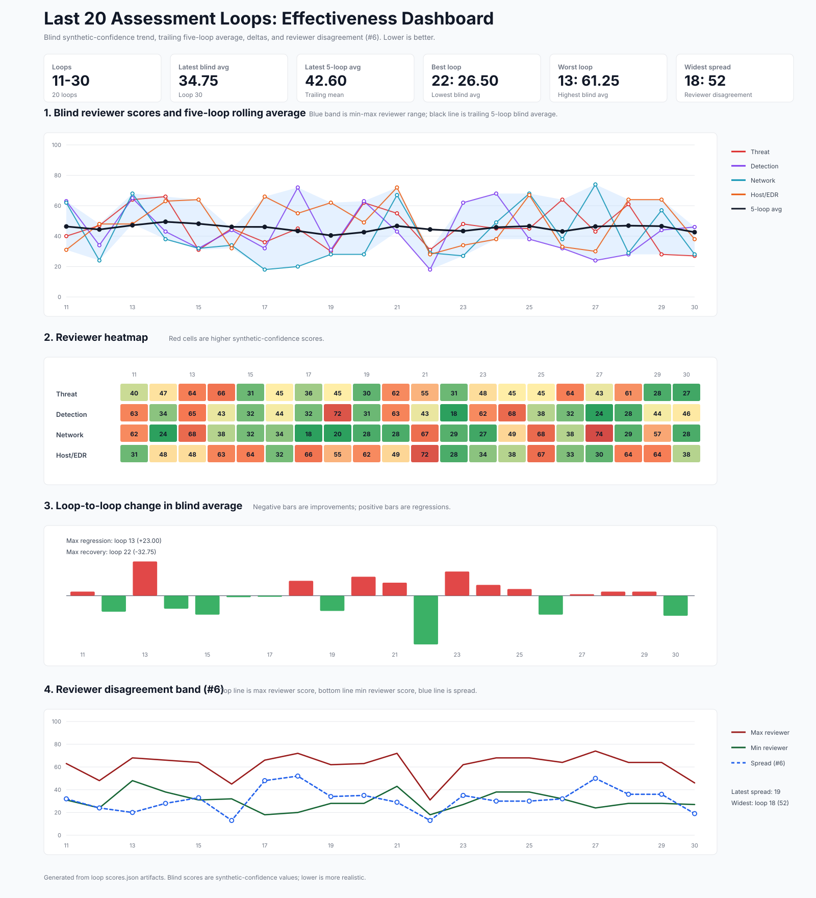

# New-epoch realism assessment — 30 completed loops

Epoch: `2026-11-20-realism`. All 30 requested assessments are complete on the approved expanded canonical scenario. Four authored file hashes and reviewer briefing/persona hashes stayed fixed. Earlier scenarios and exploratory candidate scores are excluded.

Each scored loop has an actual successful generation, one JSON evaluation with text derived from it, a fresh SHA-verified data-only copy, four independent reviewers, and actual deliberation/facilitation when triggered. The successful unreviewed behavior 567 diagnostic under loop 30 is separate and contributes no score.

## Final result

Loop 30: initial scores **27 / 46 / 28 / 38**, mean **34.75/100 — mostly realistic**. Actual deliberation: **38 / 38 / 38 / 36**, mean **37.50**, all final verdicts **Inconclusive**. Five-loop rolling initial mean: **42.60**. Automated evaluation: **98.2503008207/100**, accepted, **143,704 records**.

Lower initial synthetic-confidence is more production-like; higher deterministic evaluation is better. Deliberation is kept separate from the trend. Added loops 21–30 average 44.60 and range 26.50–59.25; this is descriptive, not a controlled causal estimate. Network scores changed 57→28 between loops 29 and 30 even though every network file is byte-identical.

The final Dovecot repair removed the observed positive-body-byte/zero-mail-count defect: **8 violations among 19 visible summaries → 0 among 20**. Only two mail-server syslog files changed; **113 of 115 files are byte-identical to loop 29**. The additional visible logout belongs to an already visible login/worker; no new canonical access is claimed.

## Scores for every loop

Reviewer order is Threat Hunter, Detection Engineer, Network Forensics, Host/EDR. Scores are original and unadjusted; verdict confidence is a separate measure retained in each loop report.

| Loop | TH | Detection | Network | Host | Initial mean | Band | Eval | Actual deliberation mean | Rolling 5 |
|---|---:|---:|---:|---:|---:|---|---:|---:|---:|
| [1](loop-1/REPORT.md) | 43 | 38 | 78 | 64 | 55.75 | mixed/inconclusive | 98.53 | 79.0 | 55.75 |
| [2](loop-2/REPORT.md) | 45 | 33 | 29 | 63 | 42.50 | mixed/inconclusive | 98.22 | 51.0 | 49.12 |
| [3](loop-3/REPORT.md) | 45 | 18 | 47 | 54 | 41.00 | mixed/inconclusive | 98.59 | 52.5 | 46.42 |
| [4](loop-4/REPORT.md) | 44 | 40 | 44 | 62 | 47.50 | mixed/inconclusive | 98.59 | 64.5 | 46.69 |
| [5](loop-5/REPORT.md) | 65 | 46 | 38 | 66 | 53.75 | mixed/inconclusive | 98.28 | 69.25 | 48.10 |
| [6](loop-6/REPORT.md) | 67 | 28 | 44 | 43 | 45.50 | mixed/inconclusive | 98.28 | 66.25 | 46.05 |
| [7](loop-7/REPORT.md) | 62 | 35 | 30 | 66 | 48.25 | mixed/inconclusive | 98.43 | 65.75 | 47.20 |
| [8](loop-8/REPORT.md) | 62 | 28 | 29 | 70 | 47.25 | mixed/inconclusive | 98.07 | 69.5 | 48.45 |
| [9](loop-9/REPORT.md) | 29 | 42 | 44 | 49 | 41.00 | mixed/inconclusive | 98.36 | 50.25 | 47.15 |
| [10](loop-10/REPORT.md) | 40 | 40 | 36 | 69 | 46.25 | mixed/inconclusive | 98.41 | 64.25 | 45.65 |
| [11](loop-11/REPORT.md) | 40 | 63 | 62 | 31 | 49.00 | mixed/inconclusive | 98.36 | 68.75 | 46.35 |
| [12](loop-12/REPORT.md) | 47 | 34 | 24 | 48 | 38.25 | mostly realistic | 98.29 | 43.5 | 44.35 |
| [13](loop-13/REPORT.md) | 64 | 65 | 68 | 48 | 61.25 | likely synthetic | 98.29 | 72.25 | 47.15 |
| [14](loop-14/REPORT.md) | 66 | 43 | 38 | 63 | 52.50 | mixed/inconclusive | 98.29 | 66.25 | 49.45 |
| [15](loop-15/REPORT.md) | 31 | 32 | 32 | 64 | 39.75 | mostly realistic | 98.29 | 61.25 | 48.15 |
| [16](loop-16/REPORT.md) | 45 | 44 | 34 | 32 | 38.75 | mostly realistic | 98.40 | Not triggered | 46.10 |
| [17](loop-17/REPORT.md) | 36 | 32 | 18 | 66 | 38.00 | mostly realistic | 98.28 | 62.5 | 46.05 |
| [18](loop-18/REPORT.md) | 45 | 72 | 20 | 55 | 48.00 | mixed/inconclusive | 98.41 | 67.5 | 43.40 |
| [19](loop-19/REPORT.md) | 30 | 31 | 28 | 62 | 37.75 | mostly realistic | 98.41 | 57.25 | 40.45 |
| [20](loop-20/REPORT.md) | 62 | 63 | 28 | 49 | 50.50 | mixed/inconclusive | 98.41 | 69.5 | 42.60 |
| [21](loop-21/REPORT.md) | 55 | 43 | 67 | 72 | 59.25 | mixed/inconclusive | 98.30 | 70.5 | 46.70 |
| [22](loop-22/REPORT.md) | 31 | 18 | 29 | 28 | 26.50 | mostly realistic | 98.30 | 30.0 | 44.40 |
| [23](loop-23/REPORT.md) | 48 | 62 | 27 | 34 | 42.75 | mixed/inconclusive | 98.16 | 64.0 | 43.35 |
| [24](loop-24/REPORT.md) | 45 | 68 | 49 | 38 | 50.00 | mixed/inconclusive | 98.25 | 68.75 | 45.80 |
| [25](loop-25/REPORT.md) | 45 | 38 | 68 | 67 | 54.50 | mixed/inconclusive | 98.25 | 74.0 | 46.60 |
| [26](loop-26/REPORT.md) | 64 | 32 | 38 | 33 | 41.75 | mixed/inconclusive | 98.25 | 63.25 | 43.10 |
| [27](loop-27/REPORT.md) | 43 | 24 | 74 | 30 | 42.75 | mixed/inconclusive | 98.25 | 71.25 | 46.35 |
| [28](loop-28/REPORT.md) | 61 | 28 | 29 | 64 | 45.50 | mixed/inconclusive | 98.25 | 62.75 | 46.90 |
| [29](loop-29/REPORT.md) | 28 | 44 | 57 | 64 | 48.25 | mixed/inconclusive | 98.25 | 63.5 | 46.55 |
| [30](loop-30/REPORT.md) | 27 | 46 | 28 | 38 | 34.75 | mostly realistic | 98.25 | 37.5 | 42.60 |

## Repairs in the ten added loops

| Loop | Selected repair |
|---|---|
| 21 | Linux virtual-console getty/login same-PID exec and root ownership; retained RDP recovery correction. |
| 22 | Windows short-process canonical lifetimes stop consuming future source-admission headroom. |
| 23 | Bounded CUPS endpoint vocabulary uses named printer URIs. |
| 24 | Linux vmstat count/interval lifetimes and GUI-owned foreground fallback. |
| 25 | Native Windows process creator and alternate child-token context. |
| 26 | Canonical Finder launch stages use scoped weights within existing exact anchors. |
| 27 | Exact Mac SSH descendant close phases preserve lifecycle bounds without arithmetic subdivision. |
| 28 | Selected installed OS objects consume existing canonical boot facts. |
| 29 | Optional generic unknown-client browser defaults preserve explicit/absent headers and known-host/frozen policies. |
| 30 | Bounded native Dovecot fetch counter coherence; explicit source_native_single_schema fallback. |

## Remaining priorities

These are synthesis priorities. Reviewers did not assign P0–P4 severity labels.

| Priority | Finding | Category | Original reviewer severity | Disposition |
|---|---|---|---|---|
| P1 | HTTP/1.1 response body ordering | hard_contradiction | Not assigned | Verified one physical conversation in two sensors; canonical response phases plus source ordering need repair. |
| P1 | Paired opaque CONNECT stream budgets | contract_gap | Not assigned | Reconcile both legs before commit, preserving TLS floors and exact recovery. |
| P1 | Authored command timing fingerprints | distribution_texture | Not assigned | Use a separate scenario version/candidate and history; keep the completed epoch frozen. |
| P2 | Zeek confirmed-analyzer/service labels | schema_or_format / contract_gap | Not assigned | Qualify exact source/version and collector policy before changing native labels. |

The final panel did not rediscover every known defect. Earlier verified findings remain open in unchanged source bytes. Shared daemon vocabulary, agent/version mixtures and user-aggregated exit history have credible ordinary alternatives and do not justify arbitrary noise or source rewriting. Loop 29's Event 4658 Version 0 ProcessName-presence allegation was rejected against official Microsoft XML; reports/scores remain original and unadjusted, and the valid field was preserved.

## Validation and provenance

The final change passed 121 focused tests, four actual public-engine cases (Linux IMAPS, OWA bypass, filtered network visibility and NAT), the three slow timing RNG policy tests, 105-file configuration validation and whole-tree Ruff checks. No full routine, full slow, packaging or release gate is claimed. All 30 report/score/manifest links, original score means, fixed authored hashes and unchanged reviewer source hashes passed [the final audit](series-audit-through-30.json).

Final generation behavior: `568`, surface SHA256 `fc245f4f08b674ae6fdbedc49e50016fd42465ae87c50bd0495db0d6f4c2fee9`. Assessments ran against authorized, uncommitted engine changes based on `b1c78393`; subsequent integration is recorded in the worklog. Product version was not bumped or published.

[Final loop report](loop-30/REPORT.md) · [Series status](SERIES.json) · [History](HISTORY.json) · [Dashboard, loops 11–30](assessment-effectiveness-dashboard-last-20-loops.svg)

